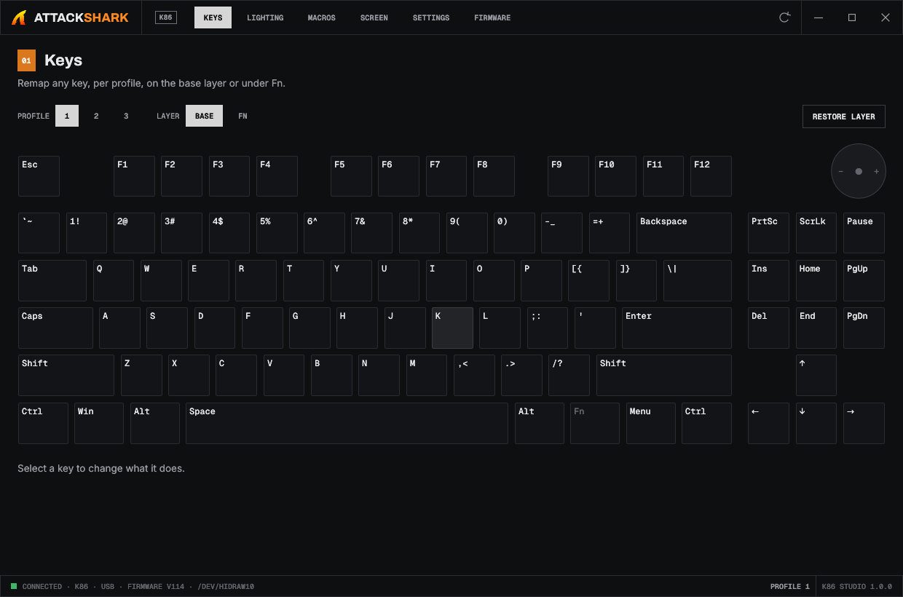
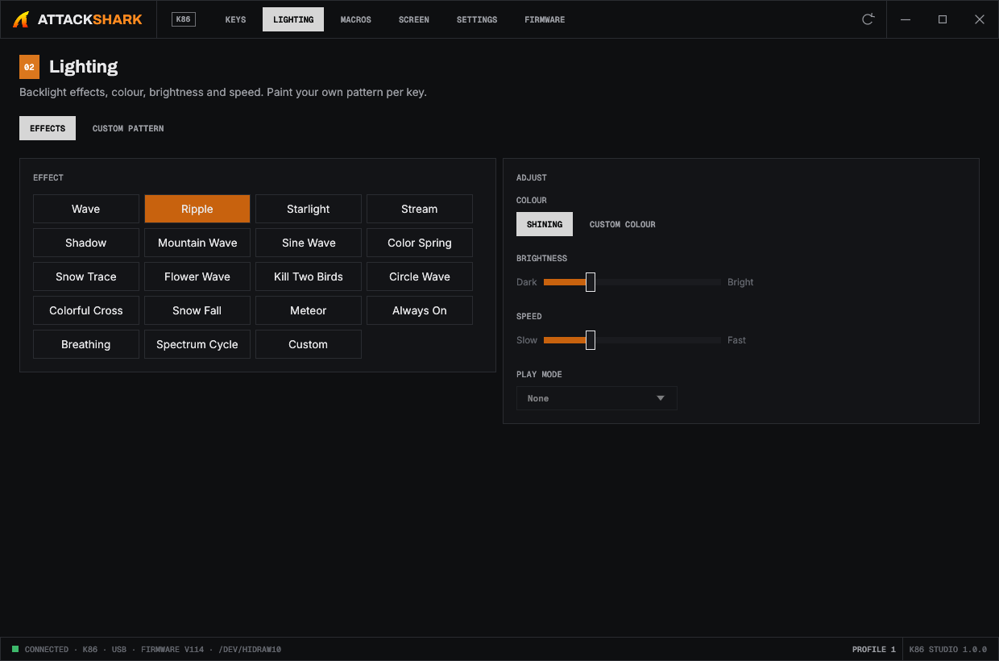
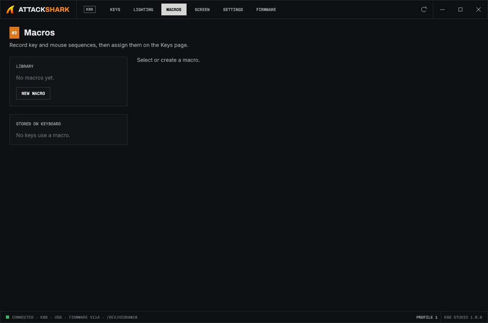
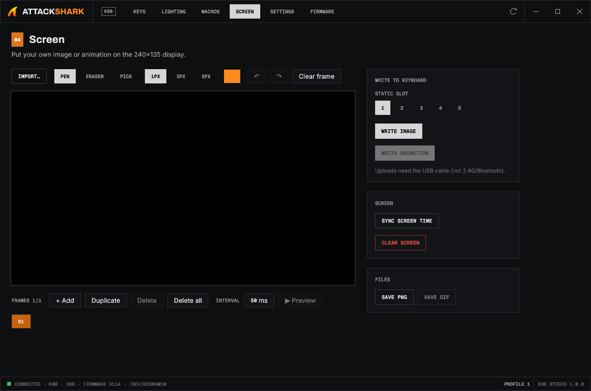
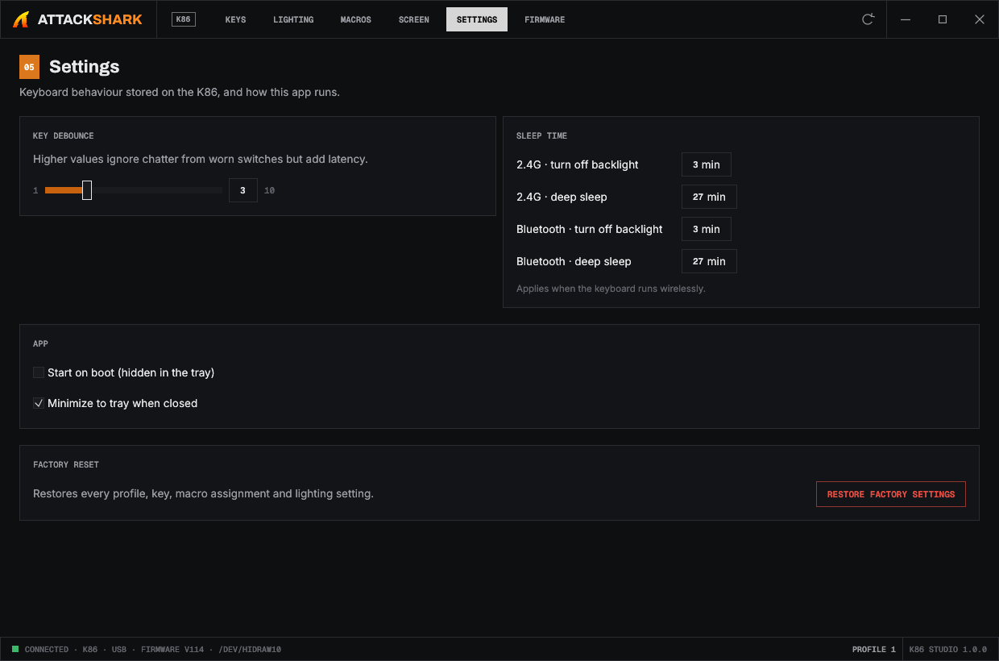
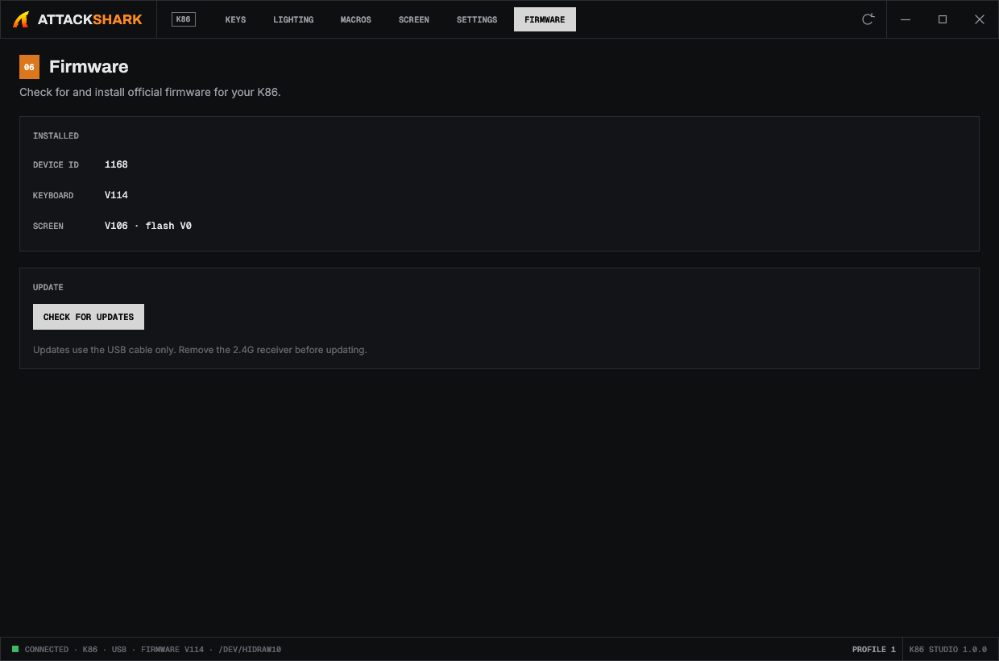

# K86 Studio

Native Linux configurator for the Attack Shark K86 (YC3121, `3151:4015`).

Attack Shark only ships a Windows configurator (`ATTACK SHARK K86 SOFT.exe`, an Electron app), and there is no native one for Linux.
This project started as a port of that Windows app: its HID protocol was carried over and rebuilt in Rust/egui, styled after ArtCraft Launcher.

## Build and run

    cargo build --release
    ./target/release/k86-studio            # --hidden starts in the tray

Allow your user to access the keyboard (once):

    sudo cp 70-attackshark.rules /etc/udev/rules.d/ && sudo udevadm control --reload

Then replug the keyboard.

## Features

- **Keys:** 3 profiles plus the Fn layer. Combos of up to 3 keys, media and mouse functions, macros, disabling keys, restoring defaults.
- **Lighting:** 19 effects with colour, brightness, speed and direction, plus custom per-key patterns 1–3.
- **Macros:** record, edit and assign, with 50 macro slots on the keyboard.
- **Screen:** 240×135 image or GIF editor, writes to slots 1–5 or as an animation, clock sync, clear screen.
- **Settings:** debounce, sleep timers, factory reset, start on boot, close to tray.
- **Firmware:** online check against the vendor server, then install. Untested on hardware; see the notes in `src/firmware.rs`.

## Screenshots

| Lighting | Macros |
| --- | --- |
|  |  |
| **Screen** | **Settings** |
|  |  |
| **Firmware** | |
|  | |

Open the app on a given page with `--page=keys|lighting|macros|screen|settings|firmware`.

## Tests

    cargo test                                        # protocol and encoding
    cargo test -- --ignored --test-threads=1          # live keyboard round trips (each restores)
